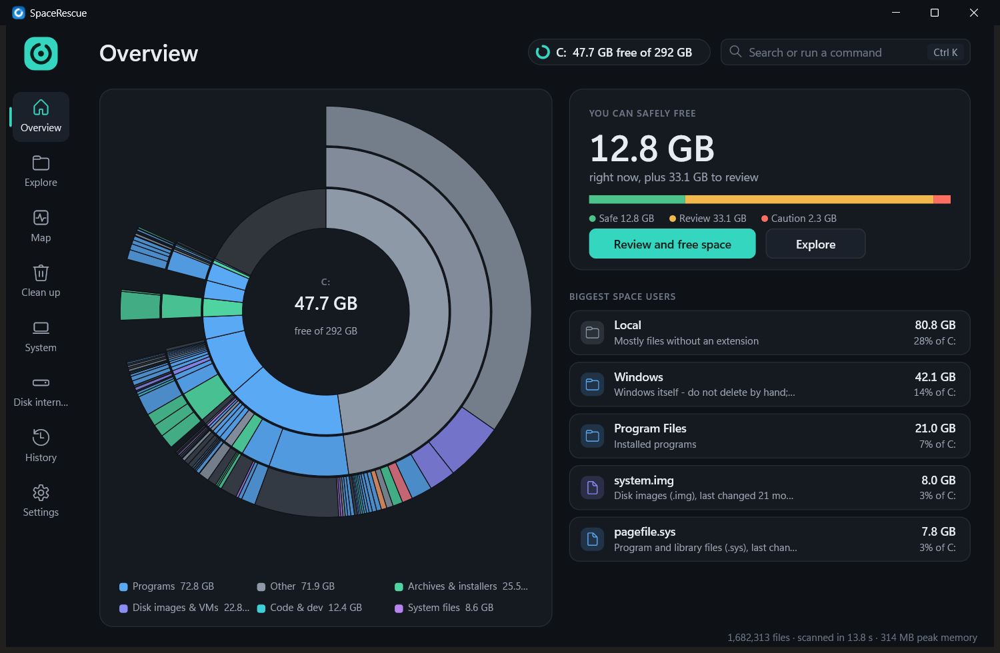

# SpaceRescue

**Disk space management that still works when your disk is completely full.**
An OS course project built on the ideas and code of [WinDirStat](https://windirstat.net) (GPL-3.0).



## Why
When the system drive reaches 0 bytes free, Windows itself starts failing, and so do most disk tools: they need
temp files, settings writes and lots of RAM. SpaceRescue is designed for exactly that moment.

## Features
| Area | What it does |
|---|---|
| **Rescue Mode** | Detects nearly-full drives. Writes nothing to them, scans in RAM with a memory cap, releases a 512 MB **reserve file** in one click (like ext4's reserved blocks), and moves files to **quarantine on another drive** with undo. |
| **Fast scanner** | 8 worker threads on `NtQueryDirectoryFile` (as upstream `FinderBasic`). C: (1.68M files) in **~11 s**, down from 58 s. An **MFT fast path** (as upstream `FinderNtfs`) reads the file table directly when elevated. Results stream in live. |
| **Overview** | A sunburst of the drive with free space in the centre, a reclaim meter split by safety (Safe / Review / Caution), and the top space users with one-line explanations. |
| **Explore and Map** | WinDirStat's tree + file types + **cushion treemap** (ported layout and shading), plus a sunburst and flame graph. |
| **Clean up** | Segmented sections: Windows temp, app caches (Chrome, Edge, Teams, Discord, Steam, ...), developer caches grouped per project (node_modules, Gradle, Cargo, pip, Android, WSL disks), and old/unused files. Every action is reversible or confirmed. |
| **System** | What Windows itself uses (hiberfil, pagefile, WinSxS, ...). Shown with a lock and the **safe Windows tool** to shrink each one, never Delete. |
| **Disk internals** | OS concepts made visible: clusters, slack space (internal fragmentation), file extents (contiguous vs fragmented allocation), MFT statistics. |
| **Low-space alerts** | A tray watcher (1.6 MB RAM) that sends a quiet notification at 50/20/10/5/3/2/1 GB and 512 MB free. |
| **Explorer and setup** | "Analyze with SpaceRescue" on folders, folder backgrounds and drives. A per-user installer, a portable zip, and no DLL dependencies. |

## Build (no Visual Studio, no admin)
```powershell
winget install MartinStorsjo.LLVM-MinGW.UCRT          # clang 23, per-user
powershell -ExecutionPolicy Bypass -File build.ps1     # -> build\SpaceRescue.exe (x64, static)
powershell -ExecutionPolicy Bypass -File package.ps1   # -> build\dist\SpaceRescue-Setup-x64.exe, SpaceRescue-portable.zip
```
`build.ps1 -Fast` for quick UI iteration (one-file rebuild in about 2 s), `-Release` for a stripped 0.8 MB exe.

## Run
| Command | Purpose |
|---|---|
| `SpaceRescue.exe [path]` | Open the app (scan `path` immediately if given) |
| `SpaceRescue.exe /preview [path] [/light\|/dark]` | The new Direct2D interface (design preview) |
| `SpaceRescue.exe /tray` | Low-space alerts in the notification area |
| `SpaceRescue.exe /install [/alerts] [/reserve]`, `/uninstall` | Per-user install / remove |
| `SpaceRescue.exe /bench C:` | Scan benchmark (elevated: also compares the MFT path) |

## Project layout
```
src/core       scanner (multithreaded + MFT), helpers, benchmark
src/rescue     Rescue Mode, reserve file, settings, reversible actions, installer/context menu
src/insights   categories, stale files, duplicates, segmented cleanup, system files
src/internals  clusters, extents, slack, MFT stats
src/viz        treemap (ported from WinDirStat), sunburst, flame graph
src/gfx        Direct2D/DirectWrite design system (DESIGN.md)
src/ui, src/ui2  current UI and the new interface preview
src/notify     tray low-space alerts
upstream/      WinDirStat source (GPL reference)
```
See [ARCHITECTURE_NOTES.md](ARCHITECTURE_NOTES.md), [CONTRIBUTIONS.md](CONTRIBUTIONS.md), [USER_GUIDE.md](USER_GUIDE.md),
[DESIGN.md](DESIGN.md), [STATUS_REPORT.md](STATUS_REPORT.md) and [PROGRESS.md](PROGRESS.md).

## Credits and license
SpaceRescue is free software under the **GNU GPL v3.0 or later** (see `LICENSE.md`). It builds on **WinDirStat**
(© WinDirStat Team: Bernhard Seifert, Oliver Schneider, Bryan Berns and contributors), whose source is included in
`upstream/`. The treemap layout and cushion shading follow WinDirStat's implementation of van Wijk & van de Wetering's
*Cushion Treemaps* (SequoiaView). Details: [CONTRIBUTIONS.md](CONTRIBUTIONS.md).

Team: Vedant ([@VedantM47](https://github.com/VedantM47)) and Shreeviraj ([@reesick](https://github.com/reesick)).
