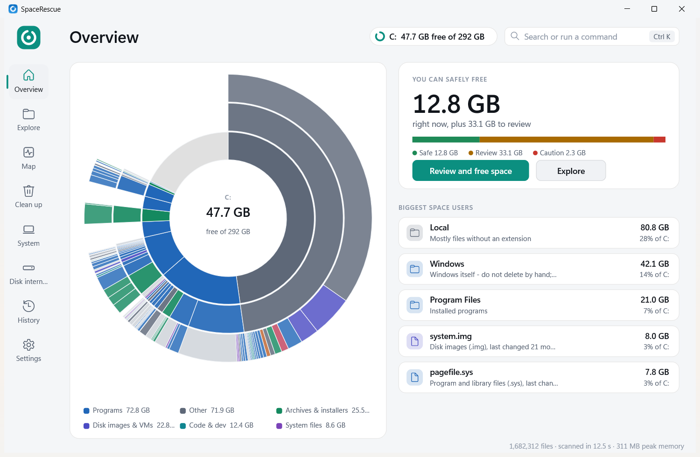

# SpaceRescue User Guide

> `SpaceRescue.exe` opens the interface shown here. Everything is clickable: drive chip (switch drive/folder), search
> (Ctrl+K), review lists with actions and Undo, System tools, Settings. The original interface is still available with
> `SpaceRescue.exe /classic`.

## 1. Install or run portable
- **Installer:** run `SpaceRescue-Setup-x64.exe`. It installs for your account only (no admin) into
  `%LOCALAPPDATA%\Programs\SpaceRescue`, adds a Start menu entry, "Analyze with SpaceRescue" in Explorer, and an
  Apps & features entry. To also turn on low-space alerts: `SpaceRescue.exe /install /alerts`.
- **Portable:** unzip `SpaceRescue-portable.zip` onto a USB stick. Settings live in `SpaceRescue.ini` next to the exe, so
  nothing is installed on the full drive. **If C: is already full, use this.**
- **Uninstall:** Settings > Apps > SpaceRescue > Uninstall, or `SpaceRescue.exe /uninstall`. This removes the program,
  shortcut, context menu, alerts and reserve file.

## 2. Find what's using space
1. Open SpaceRescue and pick a drive, or right-click a folder in Explorer and choose **Analyze with SpaceRescue**
   (Windows 11: *Show more options*).
2. The biggest folders appear while the scan runs. A full scan of a typical drive takes 5–15 seconds.
3. **Overview** shows the drive as rings: each ring is one folder level, and colour shows the kind of files
   (video, programs, disk images, ...). Free space is the grey slice. Hover over a slice for details.

## 3. Free space safely
- **Clean up** groups what can go: *Windows temp*, *App caches*, *Developer* (per project, with when you last opened it),
  and *Old and unused*. Each item has a badge:
  - **Safe**: rebuilt automatically when needed.
  - **Review**: probably fine, but check first.
  - **Caution**: your own files (videos, files not used for a year).
  - **Protected**: never delete by hand; use the suggested Windows tool.
- Open a group, tick items, then choose:
  - **Move to Recycle Bin**: easy to undo, but frees nothing until you empty the bin.
  - **Move to quarantine**: copies to another drive, checks the copy, then removes the original. Frees space now and can be undone.
  - **Compress (NTFS)**: keeps the files, uses less space.
- An **Undo** button appears after every action.

## 4. When the disk is full (Rescue Mode)
If a drive has less than 1 GB (or 2%) free, a red banner appears and SpaceRescue **stops writing to that drive**: no settings,
logs or caches. Then:
1. Click **Release reserve** to free the 512 MB reserve file instantly. Windows gets breathing room.
2. Use **Clean up** and prefer **Move to quarantine** (to your other drive) or Safe items.
3. Re-create the reserve later when there's space again.

## 5. System files
**System** shows what Windows itself uses (hibernation file, page file, component store, update cache). These are locked.
SpaceRescue shows the safe Windows way to shrink each one, such as *Turn off hibernation* or *Clean up components (DISM)*,
instead of deleting.

## 6. Low-space alerts
Run `SpaceRescue.exe /tray` (or install with `/alerts`). A small tray icon checks free space every 30 seconds and sends a quiet
notification when a drive drops below 50, 20, 10, 5, 3, 2 or 1 GB, or 512 MB. Click the notification to open SpaceRescue on that
drive. Right-click the tray icon to stop. `SpaceRescue.exe /autostart off` removes it from startup.

## 7. Disk internals (how the disk really stores files)
- **Cluster size:** the smallest block the file system hands out.
- **Slack space:** the unused end of each file's last cluster.
- **Extents:** whether a file is stored in one piece (contiguous) or many (fragmented).
- **MFT:** NTFS's table of every file.

Run as administrator to read MFT statistics.
